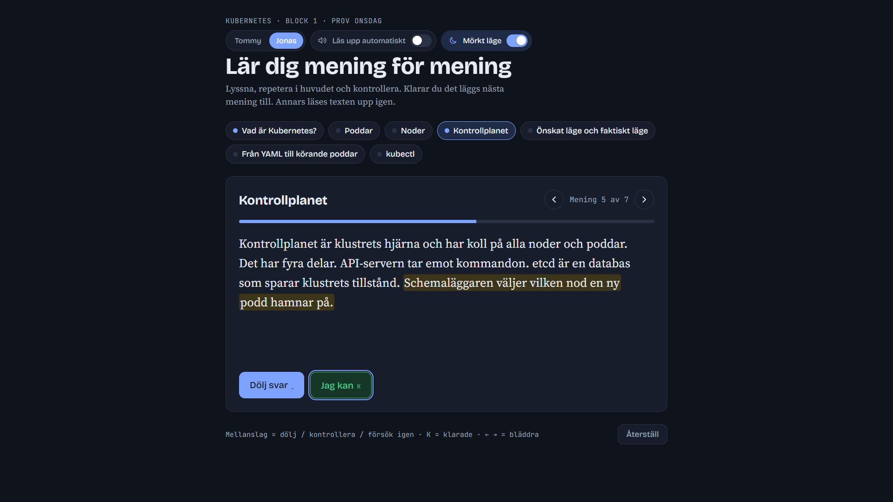
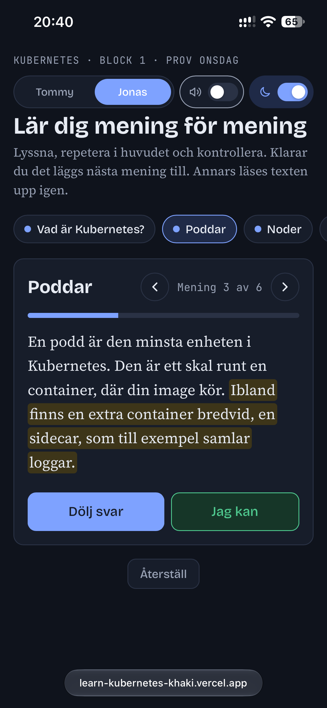

# Learn Kubernetes

En övningsapp för att lära sig Kubernetes-begrepp utantill, mening för mening.
Jag byggde den för att plugga inför ett prov i min utbildning.

**Testa den:** https://learn-kubernetes-khaki.vercel.app/





## Så fungerar den

1. En mening visas och läses upp.
2. Texten döljs och du repeterar allt hittills i huvudet.
3. Du kontrollerar svaret mot texten.
4. Klarade du det läggs nästa mening till. Annars får du försöka igen.

När alla meningar under en rubrik sitter är rubriken klar. Framstegen sparas i webbläsaren.

## Funktioner

- Uppläsning med två svenska röster att välja mellan
- Klicka på en mening för att höra den igen
- Bläddra fram och tillbaka mellan meningarna
- Ljust och mörkt läge
- Anpassad för mobil
- Går att styra helt med tangentbordet (mellanslag, K, piltangenter)

## Teknik

- **React, TypeScript och Vite**
- **ElevenLabs** för rösterna
- **Vercel** för publicering

### Val jag gjorde

- **Ljudet spelas in i förväg.** Skriptet `npm run tts` gör en MP3-fil per mening.
  Appen anropar därför aldrig ElevenLabs när den används, så den kostar inget att
  köra och API-nyckeln finns aldrig i webbläsaren.
- **Bara ändrade meningar spelas in på nytt.** Filnamnet bygger på texten och rösten,
  så skriptet hoppar över det som redan finns.
- **Logiken är skild från gränssnittet.** Alla lägen (visa, dold, kontrollera, klar)
  hanteras av en reducer i `src/state.ts`.
- **Reservröst.** Saknas ljudfiler används webbläsarens inbyggda talsyntes.

## Kör lokalt

```
npm install
npm run dev
```

Ljudfilerna följer med i repot. Vill du spela in egna, kopiera `.env.example`
till `.env`, fyll i en ElevenLabs-nyckel och kör `npm run tts`.
